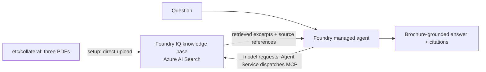

# 06 - Foundry IQ RAG: Uwes Travel hotel adviser

**KISS:** upload three fictional brochures once, then ask a small managed agent
for a hotel recommendation backed by brochure evidence. No booking system,
custom vector database, MCP client, web search, or shared app framework.
Maps to **Day 2 slides 23-30**: RAG, reusable knowledge, sources, citations,
and what to do when the knowledge base does not contain an answer.



## One-time setup - no portal upload

Use PowerShell 7, Azure CLI, .NET 10, and the same `.env`/`az login` as the other
apps. The configured Foundry account must already have the `FOUNDRY_MODEL`
deployment and a `text-embedding-*` deployment. Setup finds an existing embedding
deployment alphabetically; it does not deploy or upgrade models.

```powershell
az login
.\06-FoundryIqRag\setup.ps1
.\scripts\run.ps1 6
```

The script derives the resource group, location and project from
`FOUNDRY_PROJECT_ENDPOINT`. In this environment it creates a **dedicated Basic
Search service in `ai-130-demo`**; it never reuses a service in `rg-modelworld`.
The deterministic name is `ai103-hotels-<project hash>`; `-SearchService NAME`
can choose a different name **in that same resource group**. Setup refuses to
reuse a service without its `ai103-sample=06` tag.

Setup creates the service with a managed identity, semantic search's free
allowance and **API-key authentication disabled**, then creates only:

| Asset | Purpose |
|---|---|
| `ai103-travel-brochures` file knowledge source and generated index | Extract, chunk and vectorize the three uploaded PDFs |
| `ai103-travel-hotels` knowledge base | Reusable retrieval endpoint over that source |
| `ai103-travel-iq` project connection | `RemoteTool` / `ProjectManagedIdentity`, Search audience |

It grants Search's managed identity **Cognitive Services User** on the configured
Foundry account for embeddings, and the project's managed identity **Search Index
Data Reader** on the dedicated Search service. For setup, the signed-in CLI user
gets **Search Service Contributor** and **Search Index Data Contributor** on that
service. You need resource creation, agent/project-connection management and role
assignment permissions (for example Owner, or the corresponding least-privilege
roles). The script is for a signed-in developer, not service-principal CI.
It does not change identities, firewalls, or keys on existing resources.

The direct **file knowledge source** is a current Foundry IQ feature: it avoids a
separate Blob Storage account, storage permissions and an indexer. Upload returns
after extraction/indexing; setup checks ingestion errors. Original brochure
filenames are retained for attribution. Text extraction is `minimal`, not OCR or
paid Content Understanding. The knowledge base uses minimal/extractive retrieval:
there is no extra query-planning or answer-synthesis LLM inside Search. The
managed agent's model generates the final answer from the returned context.

Rerunning setup skips already uploaded filenames, preventing duplicate documents.
Transient upload failures are reported and retried at most three times, checking
the remote file list before retrying so a completed upload is not duplicated.
To change brochure contents, explicitly delete the corresponding remote file
before rerunning setup; it intentionally does not silently overwrite evidence.
The three local PDFs remain unchanged. Other Search content is never added.
The three non-secret `FOUNDRY_IQ_*` settings are saved to the ignored `.env`.

**Costs and lifetime:** Basic Search continues to incur charges between runs;
embeddings and model calls also cost money. Setup does not enable paid retrieval
beyond its allowance. The agent is temporary and deleted in `finally`, but the
service, knowledge base, source, uploaded PDFs, connection and role assignments
remain for reuse. After the class, explicitly delete only this tagged Search
service, its `ai103-travel-iq` connection and the Search identity's role assignment
on the Foundry account. Do **not** delete the shared Foundry resource group.

## Three-minute teaching demo

```powershell
# Thameside House: South Bank, river views and breakfast.
.\scripts\run.ps1 6 "Find a London hotel with river views and breakfast. Cite the brochure."

# Isar Garden Hotel: Haidhausen, river, terrace and modern spa.
.\scripts\run.ps1 6 "Suggest a quiet Munich hotel near the river with a spa. Cite the brochure."

# Brochures contain no room prices or live inventory: abstain.
.\scripts\run.ps1 6 "What is tonight's exact room price and availability at Thameside House?"
```

Try Paris as well: a courtyard in Le Marais points to **Le Jardin Secret**.
These are fictional agency hotel picks, not real travel advice or live offers.

Show `Program.cs`'s instructions: **when to retrieve**, **how to cite**, **what to
say when unsure**. Inspect `[retrieved evidence]` before the answer. Ask students
to locate the hotel and amenities in the original PDF, then compare the citation
and filename. Citation-looking model text is not proof of factual accuracy.
Missing information is not a technical failure: retrieval can succeed while the
correct answer is "I don't know from these brochures."

Unlike app 05, the console does not open an MCP session: **the model requests;
Agent Service dispatches; Foundry IQ retrieves**. The project connection selects
the project's identity, not the developer's CLI identity. Only
`knowledge_base_retrieve` is allowed, and approval bypass applies only to that
configured read-only tool. No personal data, booking, payments or write tool.
Creating/deleting the temporary agent is a separate management operation.

## Failure paths

- **Missing config:** run setup and use the launcher, which loads `.env`. Direct
  `dotnet run` does not load it.
- **403:** check the tenant, caller's setup roles, Search-to-model role, and
  project-to-Search role separately. New assignments can take several minutes;
  setup waits once for role propagation, then fails visibly on authorization
  errors. Rerun after propagation, not with keys.
- **404/400:** check region support and the pinned preview API/tool contracts.
  Do not substitute OpenAI `file_search` or local PDF retrieval and call it IQ.
- **Quota/allowance:** inspect Azure's reported limit; do not silently enable paid
  retrieval or enlarge the service.
- **Tool or model error/no observed retrieval:** the app refuses to label the
  response a grounded answer. Cleanup failures are visible too.
- **Unsupported question:** the model should abstain; verify this with the third
  demo question. Instructions reduce hallucination risk; they do not eliminate it.

`dotnet run --project .\06-FoundryIqRag -- --help` needs no Azure access.
Offline evidence-gate checks: `dotnet run --project .\tests\FoundryIqRag.Tests`.
See [SOURCES.md](../SOURCES.md) for current Microsoft Learn contracts and pins.
