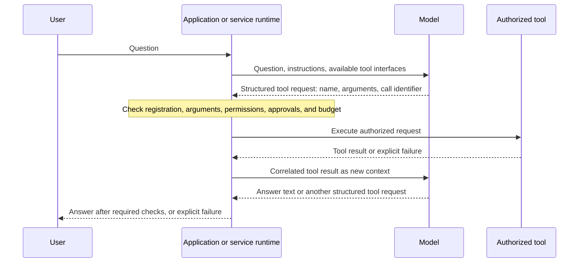
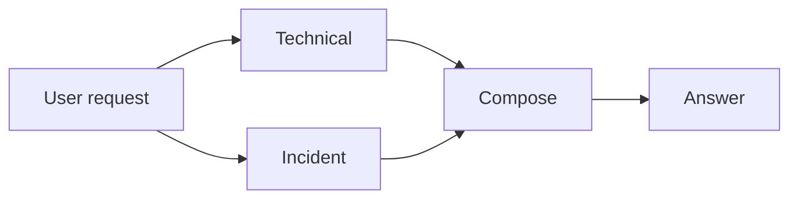
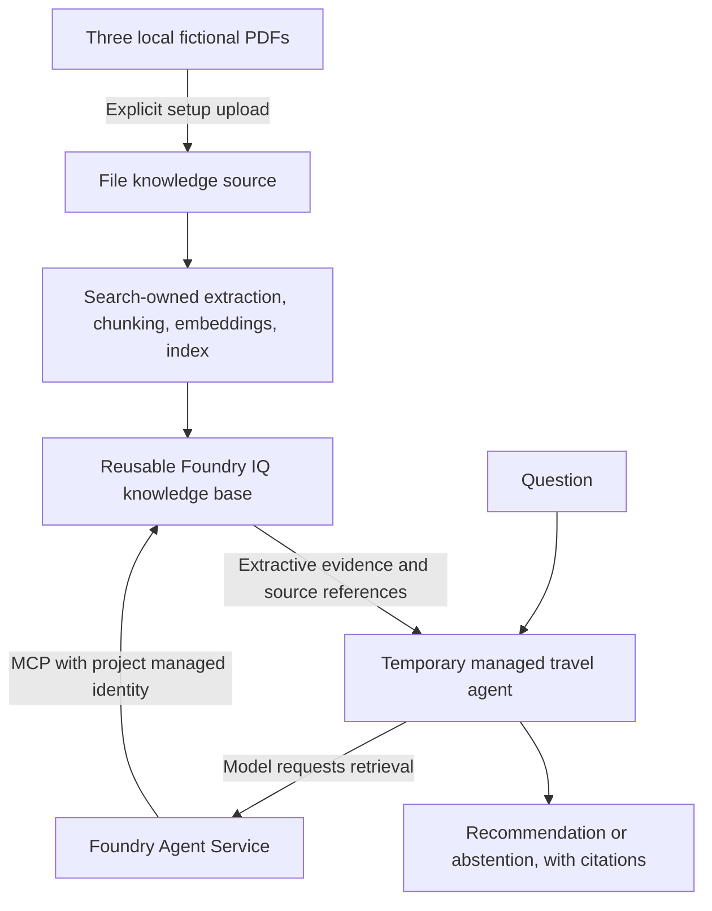

# AI-103 complete demo guide

An instructor's reference for understanding, preparing, running, and explaining
every sample in this repository, including the Responses SDK comparison,
Microsoft Learn MCP integration, Foundry IQ RAG, and optional MCP Inspector.

**Source baseline:** the checked-in implementation as reviewed on 2026-11-17.
Package and preview API names below describe these samples, not a promise that
the latest SDK documentation uses identical names. See [SOURCES.md](SOURCES.md)
for official references, compatibility notes, and previously recorded live runs.

## Contents

- [1. The teaching story](#1-the-teaching-story)
- [2. Technology and terminology](#2-technology-and-terminology)
- [How the runtime recognizes a tool call or RAG request](#how-the-runtime-recognizes-a-tool-call-or-rag-request)
- [3. Shared preparation](#3-shared-preparation)
- [4. Demo 01 - Direct Responses REST API](#4-demo-01---direct-responses-rest-api)
- [5. Demo 01B - Typed Responses SDK](#5-demo-01b---typed-responses-sdk)
- [6. Demo 02 - Manual function calling](#6-demo-02---manual-function-calling)
- [7. Demo 03 - Persisted Foundry-managed agent](#7-demo-03---persisted-foundry-managed-agent)
- [8. Demo 04 - Concurrent Agent Framework workflow](#8-demo-04---concurrent-agent-framework-workflow)
- [9. Demo 05 - Application-owned MCP client and agent](#9-demo-05---application-owned-mcp-client-and-agent)
- [10. Demo 06 - Foundry IQ RAG over travel brochures](#10-demo-06---foundry-iq-rag-over-travel-brochures)
- [11. Optional demo - MCP Inspector](#11-optional-demo---mcp-inspector)
- [12. Cross-demo comparisons and discussion](#12-cross-demo-comparisons-and-discussion)
- [13. Rehearsal and verification](#13-rehearsal-and-verification)
- [14. Troubleshooting](#14-troubleshooting)
- [15. Costs, cleanup, and operational boundaries](#15-costs-cleanup-and-operational-boundaries)
- [16. Further reading and extension exercises](#16-further-reading-and-extension-exercises)

## 1. The teaching story

These are independent teaching programs, not components of a production help
desk. Run them in sequence to make ownership boundaries progressively visible.
No sample requires another sample's executable or a shared application library.
Demo 06 has its own explicit provisioning prerequisite.

| Demo | What it adds | Execution owner | Evidence or knowledge available |
|---|---|---|---|
| 01 | Raw Responses requests and linked turns | C# application and Responses service | Prompt, instructions, prior linked responses; no company data source |
| 01B | Typed SDK for the same Responses contract | Same boundary as 01 | Same limitations as 01 |
| 02 | Strict function schema and explicit dispatch | C# application validates and executes | Three fictional ticket records in local code |
| 03 | Persisted, named, versioned agent definition | Foundry Agent Service, invoked by the application | Instructions and model; no attached knowledge or tools |
| 04 | Explicit concurrent multi-agent topology | In-process Agent Framework workflow | Separate prompt-embedded fictional technical guidance and incident snapshot |
| 05 | MCP discovery and remote tool integration | Application-owned MCP client; Agent Framework dispatch in agent mode | Public Microsoft Learn documentation |
| 06 | Reusable knowledge base and grounded generation | Agent Service dispatches retrieval to Foundry IQ | Three uploaded fictional travel PDFs |
| Inspector | Protocol inspection without an LLM | Instructor selects calls in a separate MCP client | Public server capabilities and tool results |

### Suggested delivery order and timing

For a detailed instructor session, allow approximately 90-120 minutes plus
questions. These are suggested teaching allocations, not runtime benchmarks:

| Segment | Suggested time | Main transition |
|---|---|---|
| Shared architecture and identity | 10 minutes | Separate the model, application, identity, and service |
| 01 and 01B | 15 minutes | An SDK removes transport boilerplate, not application responsibilities |
| 02 | 15 minutes | A tool request is data until application code dispatches it |
| 03 | 10 minutes | An agent definition can be a persistent cloud asset |
| 04 | 15 minutes | Workflow edges, not prose, control concurrent execution |
| 05 and optional Inspector | 15-20 minutes | Discovery and transport standardize integration, not authorization |
| 06 | 15-20 minutes | Retrieval supplies evidence; generation still needs verification |

Complete Azure provisioning, NuGet restore, and any Inspector installation
**before** the session. Demo 06 setup is not intended to fit into its short live
presentation slot.

### The recurring sentence

> The model generates text or requests an action. A runtime executes authorized
> work. Services and data sources determine what evidence is available.

Do not describe a model as directly running .NET methods, selecting Azure
permissions, learning a conversation through inference, or making a reservation.

## 2. Technology and terminology

### The layers

| Technology | Role here | What it does not imply |
|---|---|---|
| C# console application on .NET 10 | Owns startup, configuration, calls, output, and selected control flow | Production hosting, a web API, or a durable worker |
| `HttpClient` and `System.Text.Json` | Explicit HTTP/JSON in 01 and 02 | Automatic Azure token refresh or a tool execution runtime |
| Responses API | Accepts model input, produces typed output items, supports stored-response linkage | Training, a ticket database, or an application-owned conversation store |
| OpenAI .NET SDK | Typed Responses request/response and transport support in 01B | Agent Framework or a persisted agent |
| Microsoft Entra ID and `DefaultAzureCredential` | Authenticate the application; RBAC authorizes service operations | Permissions granted by instructions or by naming an agent |
| `AIProjectClient` | Project-scoped Foundry SDK access | Every use creates a persisted agent |
| Foundry Agent Service | Persists managed definitions and runs managed agents | All agents in this repository are persisted |
| `AIAgent` | Agent Framework's common execution abstraction | A definition necessarily exists as a cloud asset |
| Agent Framework Workflows | Explicit graph, executors, synchronization, streamed events | Autonomous delegation inferred from a role description |
| `Microsoft.Extensions.AI` | Common types such as `ChatMessage`, `AIFunction`, and `AITool` | A particular model, transport, or authorization policy |
| Model Context Protocol (MCP) | Tool discovery, schemas, calls, and protocol lifecycle | A model, a database, universal trust, or automatic permission |
| Foundry IQ on Azure AI Search | Knowledge source ingestion and reusable evidence retrieval | Local PDF search, OpenAI `file_search`, or fine-tuning |
| Mermaid | Text diagrams showing configured workflow and observed previews | A distributed trace or proof of factual accuracy |

### Model, deployment, endpoint, and agent are different things

- A **model** supplies inference capabilities.
- A **deployment name** identifies the deployed model to invoke. It may differ
  from the model family's name.
- A **resource endpoint** identifies the Azure resource serving model requests.
- A **project endpoint** identifies a Foundry project and its project APIs.
- A **managed agent definition** is a persisted asset referencing a model and
  instructions, optionally tools.
- A **code-defined agent** is an object configured by this program. It can use
  Foundry-hosted inference without creating a managed definition.
- A **workflow** is an execution topology around agents and other executors.
- A **knowledge base** is a reusable retrieval asset, separate from a temporary
  agent that queries it.

### State is not training

In 01 and 01B, `previous_response_id` links a new turn to retained service-side
response state. The application stores only the latest ID in memory. Restarting
the application or entering `/new` loses or clears that local pointer; it does
not delete retained responses or change model weights.

Likewise, uploading brochures in 06 builds retrievable knowledge, not a new
trained model. The retrieved text augments the answering model's context.
Neither mechanism removes context-window limits, service retention rules,
authorization requirements, or usage costs.

### How the runtime recognizes a tool call or RAG request

**Short answer:** the runtime does not guess from the wording of an answer.
Tool-capable model APIs return **structured output items** that distinguish
ordinary assistant text from a request to invoke a named tool. Application code,
Agent Framework, or Foundry Agent Service reads those typed items and dispatches
only configured, authorized tools.

There are two different decisions:

| Decision | Who makes it? | Basis |
|---|---|---|
| "Would this tool help answer the question, and with which arguments?" | The model, unless application control flow or an API tool-choice policy fixes the choice | Question, instructions, tool descriptions, argument schemas, and current context |
| "Is this output a tool request, and may it execute here?" | Application or service runtime | Protocol item type, registered tool name, arguments, permissions, approval policy, and execution limits |

The first decision is model behavior and can be wrong or omitted. The second is
explicit protocol handling and authorization logic. An instruction such as
"always retrieve first" influences the model; it does not itself execute
retrieval or prove that retrieval happened.

#### Before inference: expose the available capabilities

The model must be given a tool interface, not just told that some C# method or
knowledge base exists. The interface describes a name, purpose, and argument
shape. A tool-capable model is trained to produce tool-request output through the
API's supported mechanism; the runtime then receives a machine-readable request.
The model does not inspect local assemblies or acquire network access by itself.

In these samples, the interface is supplied in three different ways:

- **02:** C# sends the hand-authored `get_ticket_status` function definition and
  its JSON Schema in the Responses request's `tools` collection.
- **05:** the application discovers `microsoft_docs_search` through MCP, preserves
  its server-owned schema, and registers the selected `AIFunction` with the agent.
  Agent Framework makes that interface available to the model.
- **06:** the managed agent definition contains a remote MCP tool configuration:
  server endpoint, connection, and allowed name `knowledge_base_retrieve`.
  Agent Service handles the server-side MCP integration and exposes the allowed
  capability to the model; the console does not discover or dispatch it locally.

Descriptions explain **when** a tool is relevant. Schemas describe **what inputs**
it expects. Instructions set the desired behavior. Registration and allowlists
determine **which implementation can actually be invoked**. These are separate
responsibilities, not interchangeable controls.

#### During inference: text and function requests are different output types

For 02, compare these simplified Responses API output fragments. They omit other
response fields and are illustrative, not complete recorded responses.

An ordinary assistant text item looks like:

```json
{
  "output": [
    {
      "type": "message",
      "role": "assistant",
      "content": [
        { "type": "output_text", "text": "I cannot verify your company's VPN policy." }
      ]
    }
  ]
}
```

A request to use the local ticket function looks like:

```json
{
  "output": [
    {
      "type": "function_call",
      "name": "get_ticket_status",
      "arguments": "{\"ticket_id\":\"INC-1042\"}",
      "call_id": "call_example_123"
    }
  ]
}
```

The discriminator is **`type: "function_call"`**, not whether the text contains
words such as "search", "RAG", or "get_ticket_status". In this contract,
`arguments` is a JSON-encoded string that the dispatcher must parse; `call_id`
identifies the requested invocation.

If ordinary `output_text` says "I will call get_ticket_status", that sentence
alone does **not** trigger the tool. A JSON-looking snippet inside answer text
is also just text. Never implement dispatch by searching prose for function
names or executing code blocks produced by the model.

A response can contain reasoning, text, and tool-related items together. Inspect
the whole output collection, not only its first element or aggregated text.
Other APIs and SDK layers can use different type/property names; the exact
`function_call` fragment above describes 02's Responses function contract, not
every possible MCP event.

#### After a request: dispatch, return evidence, and resume inference

The normal tool-assisted answering flow is:



These are logical interactions, not necessarily separate public HTTP calls from
the console. A single `agent.RunAsync` or managed Responses request can hide
multiple inference/tool exchanges inside the runtime.

In **02**, the visible C# condition checks `type == "function_call"`. The
application then checks the exact name, validates the ticket ID, and executes
`LookupTicket`. It sends back an item shaped like this:

```json
{
  "type": "function_call_output",
  "call_id": "call_example_123",
  "output": "{\"ticket_id\":\"INC-1042\",\"status\":\"In progress\"}"
}
```

This shortened illustrative result uses the **same `call_id`** as the request.
The separate `previous_response_id` links the model turns. The model receives
the result and can formulate the answer; it did not run the lookup itself.
02 intentionally handles only one tool round, even though a general agent loop
could repeat this exchange within explicit limits.

In **05 agent mode**, Agent Framework recognizes the model's structured function
request and resolves its name to the registered `ObservedMcpTool` function.
The wrapper sends MCP `tools/call` through the application's `McpClient`, Learn
executes search, and the framework supplies the result back to the model.
The model-facing function request and the network MCP `tools/call` are related
but **different protocol steps**. `--tools-only` bypasses model selection:
the application chooses the tool and arguments directly.

In **06**, Foundry Agent Service owns the corresponding dispatch loop. It
executes the requested allowed MCP retrieval using the configured connection
and project identity, and returns retrieved evidence to the answering model.
The final service response can include both tool-call records and answer text.
The console inspects those records as SDK `McpToolCallItem` objects through
`GroundingEvidence.Validate`; it is verifying server-side work that already
happened, **not receiving a pending local instruction to execute retrieval**.

#### Where RAG fits: a retrieval tool is not a special prose signal

RAG means **retrieve evidence, augment the model context, then generate an
answer**. There is no universal model-output flag meaning "this answer is RAG".
In 06, the runtime knows that a request is a retrieval operation because its
configured server/tool mapping identifies `knowledge_base_retrieve` as the
knowledge-base retrieval capability.

For "Find a London hotel with river views and breakfast", the intended flow is:

1. The model sees the question, brochure-only instructions, and allowed retrieval
   interface. It produces a structured request with arguments for that tool.
2. Agent Service dispatches it to the configured Foundry IQ knowledge base.
3. Foundry IQ returns brochure excerpts and source references.
4. That tool result augments the model's context.
5. The model generates the recommendation and citations, or acknowledges missing
   information. The application checks observed retrieval and displays evidence.

The model does not first generate a final hotel answer that another component
then classifies as "RAG". Retrieval precedes the intended grounded final answer.
A successful retrieval can still return no matching documents; this is a reason
to abstain, not to invent content.

RAG does **not require model-selected tools** in every architecture. An
application could always retrieve before asking the model, with no tool request
from the model at all. That is a valid retrieve-then-generate design, but it is
not 06's managed MCP flow. Likewise, 04's prompt-embedded incident snapshot is
context, but no runtime retrieval happens there.

#### What if the model answers directly or requests the wrong tool?

02 explicitly uses `tool_choice=auto`, so a response without a function request
takes its text-answer path. Strict argument schema does not force the model to
choose a tool. Other API tool-choice policies can constrain selection when
supported; do not assume these samples enable a forced-choice policy.

05 and 06 instruct the model to use retrieval and also check actual execution:
05 requires successful wrapper calls with no failures; 06 requires successful,
expected MCP call records. A direct answer without observed retrieval is
rejected as an incomplete demonstration, even if it reads well.

Unknown or unauthorized tools must not execute. Valid tool requests still need
permission and argument checks; failed calls must not silently become grounded
answers. Finally, observed tool success is **necessary evidence of execution,
not proof that the final answer is true**. Verify facts and citations separately.

### Dependency map

These are **direct package references**, not the complete transitive graph.
All application projects target `net10.0`.

| Demo | Direct NuGet references |
|---|---|
| 01 | `Azure.Identity` `1.17.0` |
| 01B | `Azure.Identity` `1.17.0`; `OpenAI` `2.15.0` |
| 02 | `Azure.Identity` `1.17.0` |
| 03 | `Azure.AI.Projects` `3.0.0-beta.5`; `Microsoft.Agents.AI.Foundry` `1.28.0-preview.261106.1` |
| 04 | Same as 03, plus `Microsoft.Agents.AI.Workflows` `1.28.0` |
| 05 | Same as 03, plus `ModelContextProtocol` `2.4.0` |
| 06 | `Azure.AI.Projects` `3.0.0-beta.5`; `Azure.AI.Extensions.OpenAI` `3.0.0-beta.5` |

The managed-agent package family supplies credential types through its
transitive dependencies. Do not copy the early samples' explicit
`Azure.Identity` reference into later projects without checking compatibility;
the repository records a duplicate-type concern in [SOURCES.md](SOURCES.md).

01B locally opts into experimental Responses APIs with `OPENAI001`.
06 opts into `AAIP001` and `OPENAI001`. A stable package version can still expose
experimental API surfaces. Avoid mixing older examples using
`OpenAIResponseClient` or `ResponseCreationOptions` with these samples'
`ResponsesClient`, `CreateResponseOptions`, and `ResponseResult`.

## 3. Shared preparation

### 3.1 Workstation prerequisites

Use the repository root as the working directory for the commands in this guide.
Examples use Windows PowerShell paths:

```powershell
Set-Location C:\Demo\ai-103
dotnet --info
az version
```

Install a .NET 10 SDK. `global.json` requests `10.0.100` with
`rollForward: latestFeature`; the target framework is not changed simply by
having a different major SDK installed. VS Code with C# Dev Kit is convenient
but not required for terminal execution. Open
`AI103-Teaching.code-workspace` to use the configured solution and hide build
artifact directories.

Use **PowerShell 7** for demo 06 setup. Node.js/npm are needed only for the
optional Inspector, not for the C# MCP client.

Network access is needed for NuGet restore and the relevant Azure/public service
calls. Follow organizational proxy and certificate policies. Never disable TLS
verification to make a demonstration work.

### 3.2 Azure prerequisites

Prepare a Foundry project and a deployed text model with capabilities required
by the selected demos:

| Demos | Required capability |
|---|---|
| 01, 01B | Responses API and stored response linkage |
| 02 | Responses API and strict function calling |
| 03 | Agent definition management and model invocation |
| 04 | Foundry-backed code-defined agents and streaming workflow execution |
| 05 agent mode | Function requests over a code-defined agent |
| 06 | Managed agent with server-side MCP, supported Foundry IQ/Search preview features, and an existing embedding deployment |

The example deployment is `gpt-5.4-mini`. This is a configurable deployment name,
not a requirement to rename an existing deployment. Regional availability,
quota, permissions, and current model/tool support must be checked in your own
subscription.

Sign in and confirm the intended subscription:

```powershell
az login
az account show --query "{subscription:name,subscriptionId:id,tenantId:tenantId}" --output table
# If needed, select the intended subscription:
az account set --subscription "YOUR-SUBSCRIPTION-ID"
```

Use `az login --tenant YOUR-TENANT-ID` if tenant selection is necessary.
Do not show account details on a shared screen if they are sensitive.

Authentication and authorization are separate. A successful `az login` does
not establish model invocation, agent management, Search data access, or role
assignment permission. Demo 06 also has service-to-service identity boundaries,
described in its section.

### 3.3 Configure `.env` without overwriting existing configuration

If `.env` does not already exist:

```powershell
if (-not (Test-Path -LiteralPath .\.env)) {
    Copy-Item -LiteralPath .\.env.example -Destination .\.env
}
```

Edit the placeholders locally. Do not print or commit `.env`. The sample uses
Entra authentication, not API keys; tokens do not belong in this file.

| Setting | Used by | Meaning |
|---|---|---|
| `AZURE_TOKEN_CREDENTIALS=AzureCliCredential` | Azure-connected demos | Restricts `DefaultAzureCredential` to the Azure CLI identity for reproducible local teaching |
| `AZURE_OPENAI_ENDPOINT` | 01, 01B, 02 | Resource root, for example `https://YOUR-RESOURCE.openai.azure.com` |
| `AZURE_OPENAI_DEPLOYMENT_NAME` | 01, 01B, 02 | Actual model deployment name |
| `FOUNDRY_PROJECT_ENDPOINT` | 03-06 | `https://YOUR-RESOURCE.services.ai.azure.com/api/projects/YOUR-PROJECT` |
| `FOUNDRY_MODEL` | 03-06 | Deployment associated with the configured project/account |
| `KEEP_DEMO_AGENT` | 03 only | `true` retains this run's managed agent; otherwise it is deleted |
| `FOUNDRY_IQ_SEARCH_ENDPOINT` | 06 | Dedicated Search root; setup writes this setting |
| `FOUNDRY_IQ_KNOWLEDGE_BASE` | 06 | Setup writes `ai103-travel-hotels` |
| `FOUNDRY_IQ_CONNECTION_NAME` | 06 | Setup writes `ai103-travel-iq` |

The applications read **process environment variables**. They do not parse
`.env` themselves. The launchers load `.env` and forward application arguments.
The PowerShell loader supports simple `KEY=VALUE` lines and ignores blank lines
and comments; use unquoted simple values for this repository configuration.

Without `AZURE_TOKEN_CREDENTIALS=AzureCliCredential`, another configured identity
can be selected earlier in the credential chain. In that case, `az account show`
does not prove which identity the application used.

### 3.4 Endpoint and token-audience checks

| Connection | Configuration and route |
|---|---|
| 01/02 model REST | Resource root + `/openai/v1/responses` |
| 01B typed client | Resource root + `/openai/v1/`; SDK appends `responses` |
| 03-06 project client | Full Foundry project endpoint, including `/api/projects/PROJECT` |
| 05 MCP | Fixed public `https://learn.microsoft.com/api/mcp`; no Azure token |
| 06 knowledge-base MCP | Search root + `/knowledgebases/NAME/mcp?api-version=2026-08-01-preview` |

Do not supply an operation URL as a resource root, or substitute a project URL
for an OpenAI resource endpoint. This is a frequent cause of duplicated routes
and 404 responses.

01/02 explicitly request `https://cognitiveservices.azure.com/.default` before
each REST request. 01B uses the same audience through `BearerTokenPolicy`.
Foundry SDK clients handle their service authentication. Demo 06's project
connection uses the Search audience `https://search.azure.com/`.

### 3.5 Build before presenting

Once dependencies are available, build the seven application projects:

```powershell
dotnet build .\AI103-Teaching.slnx
```

On a new checkout or when packages are missing, explicitly restore first:

```powershell
dotnet restore .\AI103-Teaching.slnx
dotnet build .\AI103-Teaching.slnx --no-restore
```

The solution includes 01, 01B, and 02-06. Offline check projects under `tests`
are separate console applications and are not included in that solution.
Build success verifies compilation and dependency compatibility, not Azure
permissions or live model behavior.

### 3.6 Launcher and direct execution

The normal presentation commands are:

```powershell
.\scripts\run.ps1 1
.\scripts\run.ps1 1b
.\scripts\run.ps1 2
.\scripts\run.ps1 3
.\scripts\run.ps1 4
.\scripts\run.ps1 5
.\scripts\run.ps1 6
```

Each invocation is separate. Interactive apps 01, 01B, and 02 run until exit;
03-06 perform a single scripted run. Demo 06 needs setup first.

To run directly, load configuration into the current terminal once:

```powershell
Get-Content -LiteralPath .\.env | ForEach-Object {
    $line = $_.Trim()
    if ($line -and -not $line.StartsWith('#')) {
        $parts = $line.Split('=', 2)
        if ($parts.Length -eq 2) {
            [Environment]::SetEnvironmentVariable($parts[0].Trim(), $parts[1].Trim())
        }
    }
}
dotnet run --project .\01-DirectResponses
```

A terminal started later needs its own environment loading. Variables changed
in a child PowerShell process do not populate its parent terminal.

For direct `dotnet run`, use `--` before application arguments:

```powershell
dotnet run --project .\04-AgentFrameworkWorkflow -- "How should I interpret VPN error 809?"
dotnet run --project .\05-McpClientAgent -- --tools-only
dotnet run --project .\06-FoundryIqRag -- "Find a London hotel with river views."
```

The launcher inserts that separator and forwards remaining arguments:

```powershell
.\scripts\run.ps1 4 "How should I interpret VPN error 809?"
.\scripts\run.ps1 6 "Find a London hotel with river views."
```

If script execution is blocked, use the direct method after loading configuration,
or inspect and unblock only a trusted downloaded script. Do not weaken the
machine-wide execution policy.

## 4. Demo 01 - Direct Responses REST API

### What it shows

A chat-style experience built from explicit HTTP requests. The important lesson
is not chat UI: it is the contract between application, model deployment,
Responses service, instructions, output items, and retained response IDs.

**Stack:** .NET 10, `HttpClient`, `System.Net.Http.Json`, `System.Text.Json`,
`Azure.Identity`, Microsoft Entra ID, Azure OpenAI Responses v1.

**Read:** `01-DirectResponses\Program.cs`, especially request construction,
`PostAsJsonAsync`, `previousId`, and `ExtractText`.

### Preparation and run

Set `AZURE_OPENAI_ENDPOINT`, `AZURE_OPENAI_DEPLOYMENT_NAME`, and the local identity
selector; sign in. No agent definition, tools, or company data source is needed.

```powershell
.\scripts\run.ps1 1
# Or, with environment variables loaded:
dotnet run --project .\01-DirectResponses
```

### Code flow

1. Read the resource root and deployment, append `/openai/v1/responses`, and
   create an `HttpClient` with a 120-second timeout.
2. Create and reuse one credential and token request context.
3. Read console input. Ignore whitespace-only input; recognize `/new` and
   `/quit` case-insensitively after trimming. EOF exits.
4. Build a request containing `model`, `instructions`, `input`, and `store=true`.
   Add `previous_response_id` only if a previous successful response supplied an
   ID.
5. Acquire a token for this request, set its bearer header, and POST JSON.
6. On HTTP failure, print the status/body and continue without advancing the
   current chain.
7. Parse a successful JSON response, retain its ID, and traverse all output items
   for `output_text`. Print the text and stored ID.

```text
Console input -> C# request builder -> Responses service -> deployed model
                       ^                    |
                       +-- stored ID -------+
Next turn includes the previous ID; the service resolves retained context.
```

Instructions are supplied on every request. Prior response linkage should not
be treated as automatic inheritance of instructions.

### Live walkthrough

Enter these prompts separately:

```text
What is our VPN policy, and what is the status of ticket INC-1042?
What can I safely check myself?
/new
Which ticket number did I mention earlier?
/quit
```

Pause before `PostAsJsonAsync`. Show that the first request has no previous ID,
while the follow-up does. Show that only the new input is constructed locally;
the application is not resending a local message list.

The assistant should acknowledge that it cannot access internal policy or ticket
data. After `/new`, the application sends no previous ID. Do not promise exact
model wording, or treat a guessed ticket number as evidence of retained context.

### Expected evidence and learnings

- A real service-generated response ID is printed.
- Follow-up requests carry the stored ID.
- `/new` clears only the local chain reference.
- A Responses result can contain several output item types; `output[0]` is not
  guaranteed to contain answer text.
- Model fluency does not create access to internal company knowledge.
- Explicit token acquisition before each call allows the reused credential to
  refresh expiring cached tokens. `HttpClient` does not do that automatically.

### Limitations and failure behavior

This is not a full conversation management system. It does not expose usage,
durable local history, streaming, response deletion, or tool execution.
HTTP errors are handled in the loop; authentication, transport, or malformed
response failures can terminate the process. The REST sample does not have
01B's explicit `ResponseStatus.Completed` gate, so the two are comparable
teaching examples rather than byte-for-byte identical error handling.

## 5. Demo 01B - Typed Responses SDK

### What it shows

The same model conversation and explicit response-ID chaining as 01, expressed
through typed SDK objects instead of hand-built JSON and HTTP headers.

**Stack:** .NET 10, OpenAI .NET SDK `2.15.0`, `Azure.Identity`,
`System.ClientModel` bearer policy, Entra ID, the same Responses service.

**Read:** `01B-ResponsesSdk\Program.cs`. Open it alongside 01.

### Preparation and run

Reuse 01's endpoint, deployment, and identity configuration unchanged. No extra
Foundry project setting is needed.

```powershell
.\scripts\run.ps1 1b
# Or, with environment variables loaded:
dotnet run --project .\01B-ResponsesSdk
```

### Code flow and mapping

1. Create a `DefaultAzureCredential`.
2. Construct `ResponsesClient` with a reusable `BearerTokenPolicy` and a base
   endpoint ending `/openai/v1/`. `NetworkTimeout` is 120 seconds.
3. Run the same interactive input/reset/quit loop.
4. Populate `CreateResponseOptions`, including a typed user message,
   `StoredOutputEnabled=true`, and `PreviousResponseId`.
5. Print the outgoing previous ID, then await `CreateResponseAsync`.
6. Reject a response whose status is not `Completed`, without advancing the
   chain.
7. Save the successful ID, call `GetOutputText()`, and print the stored ID.
8. Report service HTTP failures through a filtered `ClientResultException`
   handler; retain the last successful chain for retry or reset.

| 01 REST concept | 01B SDK concept |
|---|---|
| JSON dictionary | `CreateResponseOptions` |
| User string in `input` | `ResponseItem.CreateUserMessageItem` |
| `store` | `StoredOutputEnabled` |
| `previous_response_id` | `PreviousResponseId` |
| Bearer header and explicit token request | `BearerTokenPolicy` |
| JSON response document | `ResponseResult` |
| Output traversal | `GetOutputText()` |
| HTTP status inspection | `ClientResultException` for service HTTP errors |

### Live walkthrough

Use the same prompts as 01 so that the variable under discussion is the client
abstraction, not a different scenario. Break on `CreateResponseAsync` and inspect
`options.PreviousResponseId`, `options.InputItems`, `response.OutputItems`,
`response.Status`, and `response.Id`.

Show `/new`, blank input, and `/quit`. Both command checks trim input and ignore
case. The outgoing previous-ID trace makes reset especially easy to demonstrate.

### Expected evidence and learnings

The application still chooses instructions, endpoint, identity, deployment,
linkage, reset behavior, and error presentation. The SDK owns serialization,
transport policies, typed responses, and token acquisition/refresh.

`GetOutputText()` aggregates text; it neither executes a tool call nor validates
the truth of the text. A nonempty answer is not proof of grounding.

### Limitations and failure behavior

No tools, company knowledge, managed agent, or Agent Framework orchestration
have been added. `/new` does not delete stored responses. Missing configuration
fails at startup. Credential and transport failures propagate rather than
falling back to anonymous access or a key. An empty text result is explicitly
reported; inspect output items rather than assuming a text-only response.

## 6. Demo 02 - Manual function calling

### What it shows

The model requests a named function using a JSON contract. Your C# application
authorizes the name, parses and validates arguments, executes a local read-only
lookup, and returns a correlated tool result to the model.

**Stack:** same HTTP/JSON/authentication foundation as 01, strict JSON Schema,
Responses function-call output items, local C# dispatch.

**Read:** `02-ManualToolCalling\Program.cs`: `ticketTool`, the `calls` loop,
`LookupTicket`, `SendAsync`, and `function_call_output`.

### Preparation and run

Reuse 01's resource configuration, with a deployment supporting strict function
calling. There is no ticket service to provision.

```powershell
.\scripts\run.ps1 2
# Or, with environment variables loaded:
dotnet run --project .\02-ManualToolCalling
```

### The fictional records

| Ticket | Status | Owner | Note |
|---|---|---|---|
| `INC-1042` | In progress | Network operations | VPN login failure; diagnostics underway |
| `INC-1207` | Resolved | Service desk | Password reset completed |
| `INC-1888` | Waiting for user | Endpoint support | Please confirm device OS |

These are deterministic local fixtures. They are not shared live state with
04's separate incident snapshot, even when the ticket identifier matches.

### Code flow

1. Define `get_ticket_status` as a strict function with one required string,
   `ticket_id`, and `additionalProperties=false`.
2. For each question, start a fresh stored response chain. Send instructions,
   the function definition, `tool_choice=auto`, and `parallel_tool_calls=false`.
3. Inspect **all** output items and collect any `function_call` requests.
   The initial response can also contain reasoning or ordinary text.
4. If there are no function calls, print the text and return to input.
5. For each requested call, print its name, arguments, and `call_id`.
6. Check that the name is exactly `get_ticket_status`. An unknown name produces
   an error result; it is not reflected into an arbitrary .NET method.
7. Parse arguments and check the ticket ID against `^INC-[0-9]{4}$`.
   Report handled invalid arguments as a structured tool error.
8. Execute `LookupTicket` locally. A syntactically valid but absent ID returns
   `Not found`, not an invented status.
9. Send `function_call_output`, using the original `call_id`, in a second
   Responses request linked by `previous_response_id`.
10. Print the model's natural-language interpretation of the tool result.

```text
User -> model
        |
        +-> function_call(name, JSON arguments, call_id)
                         |
              C# allowlist and validation
                         |
                   local lookup
                         |
        function_call_output(call_id, JSON result)
                         |
                       model -> user-facing answer
```

`call_id` correlates a tool result with a particular requested invocation;
the response ID links the model turns. They are not interchangeable identifiers.

### Live walkthrough

```text
What is the status of ticket INC-1042?
What is the status of ticket INC-1207?
What is the status of ticket INC-9999?
What is our VPN policy?
/quit
```

Break **before** the dispatch loop. At this point the model has requested work,
but no lookup has executed. Step into `LookupTicket`; then inspect the
`function_call_output` sent back to the service.

The unknown ticket should produce the local `Not found` result. A policy question
demonstrates that providing one tool does not supply every type of company data.
Because `tool_choice` is automatic, inspect observed output rather than promising
that every wording always produces a tool request.

### Learnings

- JSON Schema is the model-visible interface, not the implementation.
- Strict schema mode improves request shape but does not replace runtime
  authorization, business rules, or robust parsing.
- The application, not the model, owns local execution.
- Tool data is input to a second inference step, not automatically the final answer.
- Disabling parallel calls limits this first model response to at most one call;
  it does not execute the call or implement a multi-round loop.

### Important simplifications

Each console question starts fresh; there is no cross-question chat history and
no `/new` command. `/quit` is case-insensitive but, unlike 01/01B, is not trimmed.
Use it without surrounding spaces.

The sample intentionally stops after **one tool round**. It does not continue
if the second model response requests further work. The tool-result request
contains the deployment, previous ID, outputs, and storage setting; it does not
repeat the first request's instructions/tools. Do not present this as a complete
production agent loop or as proof that previous instructions persist.

The argument checks are deliberately small, not a complete server-side JSON
Schema validator for every malformed type or shape. Service HTTP failures throw.
There is no retry policy, approval UI, ticket write path, or general-purpose
method execution mechanism.

## 7. Demo 03 - Persisted Foundry-managed agent

### What it shows

A named, versioned declarative definition becomes a cloud asset in Foundry.
Creating that asset, invoking its model, and running the local console are
separate operations.

**Stack:** .NET 10, `Azure.AI.Projects`, Foundry Agent Service,
`Microsoft.Agents.AI.Foundry`, `AIAgent`, Entra ID.

**Read:** `03-FoundryManagedAgent\Program.cs`: `CreateAgentVersionAsync`,
`DeclarativeAgentDefinition`, `AsAIAgent(version)`, and `finally`.

### Preparation and run

Set `FOUNDRY_PROJECT_ENDPOINT` and `FOUNDRY_MODEL`. The developer identity needs
permission both to manage agents and to invoke the model.

```powershell
.\scripts\run.ps1 3
# Or, with environment variables loaded:
dotnet run --project .\03-FoundryManagedAgent
```

For portal inspection after execution, temporarily set
`KEEP_DEMO_AGENT=true` in the local `.env`, then use the launcher. Restore it to
`false` afterward. Alternatively, after loading configuration into the current
terminal, use a direct invocation:

```powershell
$env:KEEP_DEMO_AGENT = 'true'
dotnet run --project .\03-FoundryManagedAgent
$env:KEEP_DEMO_AGENT = 'false'
```

The launcher reloads `.env`, so a conflicting value there overrides an earlier
terminal-only change when you use the launcher.

### Code flow

1. Construct `AIProjectClient` with the project endpoint and credential.
2. Generate `ai103-helpdesk-` plus eight random hexadecimal characters.
3. Call `AgentAdministrationClient.CreateAgentVersionAsync` with a
   `DeclarativeAgentDefinition` containing model and instructions.
4. Print the created version so the instructor can locate it in Foundry.
5. Adapt the persisted version to `AIAgent` with `project.AsAIAgent(version)`.
6. Run one fixed VPN troubleshooting question.
7. In `finally`, either keep the agent or call `DeleteAgentAsync(name)`.

The default query asks for safe VPN troubleshooting and what the assistant
cannot verify. This sample is **not interactive**, and its console query is not
replaced by the prompt printed in the shorter project README.

### Live walkthrough

Run with retention enabled, open the correct Foundry project, and locate the
exact generated agent name. Inspect its version, deployment reference, and
instructions. Explain that this program creates a fresh unique name for each
execution; it does not demonstrate updating an existing name through several
versions.

Compare these three objects explicitly:

1. The local C# console and credential.
2. The persisted agent definition/version.
3. The deployed model that generates the reply.

The reply should avoid claiming access to real internal tickets or policies.
Do not infer knowledge access merely because a managed definition exists.

### Learnings and boundaries

`AsAIAgent` supplies a common execution interface. In this overload it wraps
a persisted Foundry version; that does not mean every `AIAgent` is persisted.
The next sample uses code-defined agents through the same abstraction family.

No retrieval, local ticket function, MCP tool, approval mechanism, or workflow is
attached. The agent has only instructions and a model.

### Cleanup and failure behavior

By default, the program deletes the **whole uniquely named agent**, not merely
one version. That is safe within this sample's generated-name boundary.
Invocation failure still enters `finally`; cleanup failure is not hidden.
If the process is forcibly terminated, inspect the portal for leftover
sample-owned agents. Retained agents require explicit manual cleanup.

Deleting one run's agent does not delete previously retained agents, model
deployments, or the project.

## 8. Demo 04 - Concurrent Agent Framework workflow

### What it shows

Two independent specialist agents receive the same question concurrently. A
collector waits for both and invokes a third agent once to reconcile their
findings. Workflow edges, not agent instructions, enforce this topology.

**There are three agents, not two:** Technical and Incident investigate in
parallel; Compose turns their findings into one user-facing answer. The two
specialists are not strictly necessary to solve this small question. They are
separate to make concurrent orchestration and evidence reconciliation visible.

**Stack:** .NET 10, Foundry project/model SDK, code-defined `AIAgent` objects,
`Microsoft.Agents.AI.Workflows`, typed executors, `ChatMessage`, streaming events,
and a local Mermaid presentation helper.

**Read these files together:**

| File | Teaching focus |
|---|---|
| `04-AgentFrameworkWorkflow\Program.cs` | Agent roles, bindings, input, event stream, observed outputs |
| `04-AgentFrameworkWorkflow\ConcurrentSupportWorkflow.cs` | Fan-out, barrier, delivery-step buffering, single composition |
| `04-AgentFrameworkWorkflow\WorkflowDiagram.cs` | Safe diagram rendering and literal output previews |

### Preparation and run

Use the Foundry project/model configuration. No persisted agent definition is
created, no external ticket system is queried, and no new service is provisioned.

```powershell
.\scripts\run.ps1 4
.\scripts\run.ps1 4 "How do I troubleshoot VPN error 809?"
# Or, with environment variables loaded:
dotnet run --project .\04-AgentFrameworkWorkflow
```

The default question is:

```text
My Northstar VPN in Europe fails with error 809 after a password change. Is INC-1042 related?
```

Command-line arguments replace the question; they do not change the topology.

### Why split the work between two specialists?

Think of a service desk consulting two colleagues before answering a caller:

- **Technical asks: "What could cause these symptoms?"** It has troubleshooting
  guidance about error 809, but no incident records.
- **Incident asks: "Does our incident snapshot contain a relevant outage?"** It
  has one outage record, but does not see Technical's analysis.
- **Compose asks: "Given both findings, what should we tell this user?"** It
  weighs the evidence and preserves uncertainty instead of simply joining text.

The distinction is **possible causes versus a specific recorded event**.
These are different questions about the same user request, not the same question
asked twice to get a majority vote.

The password change is a deliberate distraction. A plausible story is "the
password change broke the VPN", but neither the error-code guidance nor the
timing proves that. The incident snapshot supplies a different, more specific
piece of evidence: other users report the same error on the same VPN in the
same region.

| If we used only... | What it could contribute | What would be missing |
|---|---|---|
| Technical | Error 809 can mean gateway reachability or local network trouble; record the error/time and check ordinary internet access | It has no evidence of the matching shared outage |
| Incident | The fictional snapshot records an active Northstar VPN Europe outage affecting multiple users with error 809 | It does not provide Technical's separate symptom analysis and safe observations, and cannot confirm this user's cause |
| Both, then Compose | Explain why the outage is relevant while retaining safe observations and uncertainty | Still no live status or confirmed per-user diagnosis |

This makes the **join** meaningful: the final answer should change when the
second source of evidence is considered. It should not merely repeat two similar
opinions.

### Walk the example through in plain English

These are illustrative summaries of the intended contributions, **not fixed
output or three separate user conversations**:

1. **User:** "My Northstar VPN in Europe fails with error 809 after a password
   change. Is INC-1042 related?"
2. **Technical, independently:** "TECH-809 says this error can involve an
   unreachable gateway or a local network issue. The password-change timing does
   not establish the cause. Record the error and time and check ordinary internet
   access. I have no incident records."
3. **Incident, independently:** "The fictional INC-1042 snapshot describes an
   active Northstar VPN Europe outage with multiple error-809 reports. That
   matches important parts of this request, but the snapshot gives no ETA or
   confirmed diagnosis for this user."
4. **Compose, after both:** "The matching fictional INC-1042 outage is a stronger
   lead than assuming the password change caused this. TECH-809 still allows
   other causes, so this user's root cause is not confirmed. Record the error
   and time and check ordinary internet access; the snapshot is not live status
   and contains no restoration estimate."

Steps 2 and 3 run in parallel, not in the numbered order used to explain them.
Neither specialist reads the other's output. Only Compose receives the original
question **and both attributed findings**. Its job is synthesis, not another
lookup, a vote, or choosing which specialist gets to run.

### Could one agent do all of this?

**Yes.** For these tiny, fixed fixtures, one agent given both the guidance and
incident snapshot could produce the same quality of answer with less orchestration
and potentially fewer tokens and lower latency. A deterministic retrieval step
followed by one answering agent could also be a reasonable design. The demo does
not prove that three agents are better than one.

The split is useful here for teaching explicit fan-out, independent contexts,
waiting for all required results, attributed evidence, and one final composition.
In a larger application, separate specialists may be justified by substantial
independent tasks, different tools or knowledge sources, or separately evaluated
responsibilities. Those benefits must outweigh extra model calls, composition
cost, latency, and failure handling.

In **this** implementation, the differences come from separately supplied
instructions and prompt-embedded evidence, not separate trained models, Azure
identities, live data connections, or tool permissions. The same model can repeat
the same mistakes in both branches; separate agents do not guarantee independent
reasoning or more truthful output. Role prompts are not security boundaries.

### Evidence and agent roles

| Agent | Its available evidence | Its intended contribution |
|---|---|---|
| Technical | Fictional `TECH-809`: possible gateway reachability or local network/firewall issue | Tentative explanation, safe observations, missing evidence |
| Incident | Fictional `INC-1042`: active Northstar VPN Europe outage, multiple error-809 reports, no ETA | Relevance of the fixed incident snapshot |
| Compose | Original question and both attributed findings | Reconcile stronger matching outage evidence with uncertainty about this user's cause |

The records are **prompt-embedded fixtures**, not tool calls or retrieved live
documents. Technical cannot see the incident finding; Incident cannot see the
technical finding. All three agents share one deployment and credential, not
one specialist conversation.

The prompts target at most 120 words per specialist and under 180 words for the
composer. These are model instructions, not mechanically enforced output limits.

### Explicit topology



The input node is a `ChatForwardingExecutor`, not a fourth routing model.
Both specialists always run. There is no model-selected branch, group chat,
autonomous handoff, or adaptive Magentic planner.

### Code flow

1. Create the project client, then three code-defined agents using
   `AsAIAgent(model:, name:, instructions:)`.
2. Bind both specialists as executors with `ForwardIncomingMessages=false`.
   This prevents duplicate incoming questions from being forwarded as findings.
3. Create `SupportComposerExecutor`, retaining the original question and the
   expected specialist names.
4. Build the graph with `AddFanOutEdge`, `AddFanInBarrierEdge`, and
   `WithOutputFrom(composer)`.
5. Start `InProcessExecution.RunStreamingAsync` with a user message.
6. Send a `TurnToken(emitEvents: true)` to trigger processing.
7. Watch streamed workflow events. Print executor-attributed updates and append
   text deltas into separate buffers.
8. The barrier releases both branches' messages into a delivery step.
   `HandleAsync` buffers them; `OnMessageDeliveryFinishedAsync` verifies both
   attributed assistant findings before invoking Compose **once**.
9. The composer streams its answer, emits attributed updates, and yields the
   terminal string output.
10. Verify completion and nonempty output from all stages. Then print the
    Mermaid run summary.

Calling Compose once per `HandleAsync` delivery would create multiple or partial
answers. Buffering through the end of the delivery step is part of the central
lesson, not incidental plumbing.

### Live walkthrough

Before running, show Technical's `TECH-809` instructions and Incident's
`INC-1042` snapshot side by side. Ask: "What information would we miss if we
consulted only this specialist?" Use the table above to establish the two
different tasks before introducing workflow APIs.

Then run the default question and watch branch updates interleave. Label the
contributions aloud: **possible causes**, **matching outage evidence**, and
**combined recommendation**. The matching outage is stronger evidence than a
speculative local diagnosis, but neither proves this user's root cause. The
password-change timing is not proof of causation.

Pause on the barrier and collector. Ask why the composer must wait for **both**
findings and how a sequential pipeline would differ. In a sequential pipeline,
later agents can build on earlier results; these specialists deliberately
provide independent perspectives.

After completion, inspect the final Mermaid text. Use a trusted local renderer
for anything sensitive; the provided fictional previews can be pasted into
Mermaid Live if desired.

### What the diagram does and does not prove

The renderer uses the same specialist collection as the graph. It includes
roles and literal observed text previews, normalized for whitespace, capped at
240 Unicode text elements including `...`, and escaped so model text cannot
become Mermaid structure or HTML.

Arrows show configured topology. Previews show captured text from this run.
This is **not** a timing trace, token-usage report, extra model-generated summary,
or proof that the recommendations are correct. Truncation can omit qualifications;
use the full console output for interpretation.

### Failure behavior and learnings

Workflow errors, failed executors, unknown output executor IDs, missing findings,
empty composition, and incomplete runs fail explicitly. A branch failure is not
equivalent to "no incident exists"; the sample refuses a plausible partial answer
and does not print a completed-run diagram.

Concurrency can reduce part of the wall-clock critical path, but it does not
guarantee faster execution or lower cost. There are two specialist invocations
plus composition, and the composer processes both findings. Stream order and
model wording vary.

## 9. Demo 05 - Application-owned MCP client and agent

### What it shows

An application opens a real MCP client session, discovers server-owned tool
schemas, allowlists one public search tool, and either calls it directly or
registers it with a code-defined agent.

**Stack:** .NET 10, `ModelContextProtocol` C# SDK, Streamable HTTP,
`McpClientTool`/`AIFunction`, `DelegatingAIFunction`, Microsoft Learn MCP server;
Foundry and Agent Framework only for the agent path.

**Read:** `05-McpClientAgent\Program.cs` and
`05-McpClientAgent\ObservedMcpTool.cs`.

### Two distinct modes

| Mode | Who selects the call? | Azure/model requirement | Result |
|---|---|---|---|
| `--tools-only` | Application supplies fixed arguments | None | Raw remote search result |
| Default agent mode | Model requests the registered function | Foundry project, model, identity | Model answer after observed successful search |

Both require network access to public Microsoft Learn. Neither needs Node.js,
Inspector, a local MCP server, or a persisted agent definition.

### Preparation and run

Start without Azure to isolate the protocol:

```powershell
dotnet run --project .\05-McpClientAgent -- --tools-only
```

Then use the configured project/model:

```powershell
.\scripts\run.ps1 5
# Or, with environment variables loaded:
dotnet run --project .\05-McpClientAgent
```

The accepted application arguments are exactly none or `--tools-only`.
Arbitrary question text and unsupported flags are rejected. The fixed public
questions are intentional data-handling boundaries, not an interactive search UI.

### Code flow

1. Validate arguments and, in agent mode, require model configuration before
   opening the MCP connection.
2. Establish a two-minute cancellation deadline for the run.
3. Open `HttpClientTransport` in `StreamableHttp` mode against
   `https://learn.microsoft.com/api/mcp`, then create `McpClient`.
4. Discover tools with `ListToolsAsync`; print names, descriptions, and input
   schemas.
5. Select exactly `microsoft_docs_search`. Fail if it is absent; do not silently
   select a similar tool or register every discovered capability.
6. Wrap that discovered tool in `ObservedMcpTool`, preserving its metadata and
   server-owned schema.
7. In direct mode, invoke it with the fixed query
   `Agent Framework .NET MCP tools client server`.
8. In agent mode, pass the wrapper to `AsAIAgent(tools: [searchTool])` and run the
   fixed public question about .NET Agent Framework MCP responsibilities.
9. Agent Framework dispatches the model's function request to the wrapper. The
   wrapper calls `McpClient.CallToolAsync`; the Learn server executes search.
10. Require at least one successful observed call and no failed attempts before
    printing the agent result as a completed demonstration. Dispose the session
    asynchronously after the run, including failures.

```text
Application -> MCP initialize/discovery -> Learn
                         |
               allowlisted discovered schema
                         |
Model function request -> Agent Framework -> ObservedMcpTool
                                               |
                                     MCP tools/call -> Learn search
                                               |
                         reference data -> model -> cited answer
```

In `--tools-only`, the model and Agent Framework dispatch path are absent.

### The wrapper's responsibilities

`McpClientTool` already derives from `AIFunction`. The wrapper does not implement
search locally or replace the discovered schema with a hand-authored one.
It makes the dispatch boundary observable and enforces:

- A maximum of three attempted calls, counted atomically.
- Explicit failure for MCP `isError=true`, even if transport succeeded.
- Successful/failed call accounting, including protocol or transport exceptions.
- Rejection of an agent run with any failed attempt, even after an earlier success.

A fourth attempted call is rejected before it reaches the server. Agent
Framework may return function exceptions to the model as recovery context;
the final counters prevent a fluent recovery answer from concealing a failed
demonstration.

### Live walkthrough

Run direct mode and identify initialization, discovered schemas, the runtime's
`tools/call` marker, and the server's success marker. Ask where the model is:
**there is none**.

Then run agent mode and show the same dispatch boundary after the model receives
the registered tool. Inspect source links in the answer and compare them with
the search data. A successful protocol call does not establish that every
sentence or citation in the final answer is accurate.

Contrast with 02: the function name and schema are discovered rather than
hand-authored, and execution occurs on the Learn server rather than in a local
ticket method. The application still controls registration and permissions.

### Data and trust boundaries

Azure credentials are used only for the Foundry connection, never copied into
the public MCP transport. Learn requires no key or sign-in. Search arguments go
to Learn; the registered schema, prompt, and tool results enter the model's
context. Arguments are not logged by the wrapper.

Remote content is untrusted reference data, not permission to follow embedded
instructions. Discovery is not authorization. Do not extend the endpoint list,
add write tools, or send private tickets or personal data without a separate
review and authorization.

### Failure behavior and learnings

Missing discovery, unsupported arguments, timeout, protocol/transport failures,
server tool errors, no observed search, or exceeded budget cannot become an
apparently successful grounded run.

A browser GET returning 405 from the Learn endpoint is not a valid MCP failure
test. Use an MCP client with Streamable HTTP. A tool-only server need not expose
resources or prompts.

## 10. Demo 06 - Foundry IQ RAG over travel brochures

### What it shows

Three fictional brochures are ingested once into a reusable Foundry IQ knowledge
base. A temporary managed agent retrieves brochure evidence, generates a
recommendation, cites its sources, and should abstain when the brochures lack
the requested facts.

This is a real managed retrieval integration. The console does not parse PDFs,
host a vector store, or run an MCP client.

**Stack:** .NET 10, Foundry Agent Service, `Azure.AI.Projects`,
`Azure.AI.Extensions.OpenAI`, typed Responses, server-side MCP, project managed
identity, Azure AI Search/Foundry IQ, an existing embedding deployment,
PowerShell 7, Azure CLI, ARM and Search REST APIs.

**Read:**

| File or directory | Purpose |
|---|---|
| `06-FoundryIqRag\setup.ps1` | Resource provisioning, roles, PDF uploads, knowledge source/base, project connection, local settings |
| `06-FoundryIqRag\Program.cs` | Managed agent/tool configuration, one question, observed retrieval, answer, temporary-agent cleanup |
| `06-FoundryIqRag\GroundingEvidence.cs` | Rejects missing, failed, or unexpected retrieval |
| `etc\collateral` | The three original fictional source PDFs |

### Architecture: setup and runtime are separate



The file source owns ingestion configuration. Search owns extraction, chunking,
vectorization, and its generated index. The knowledge base returns extractive
data with minimal retrieval reasoning effort; this sample does not configure
an additional Search planning/synthesis LLM. The managed agent's model produces
the final natural-language answer.

### One-time prerequisites

In addition to shared Foundry configuration, prepare:

- PowerShell 7 and an interactive Azure CLI developer sign-in.
- An existing `text-embedding-*` deployment in the configured Foundry account.
  Setup chooses the alphabetically first matching deployment; it does not create
  or upgrade one.
- An existing deployment matching `FOUNDRY_MODEL`.
- A Foundry project with a managed identity. The script refuses to change an
  existing project's identity to compensate for a missing one.
- Permission for resource creation, agent/project-connection management, and
  role assignments, plus the required data-plane roles.
- Regional availability and quota for the pinned Search/IQ preview contracts.
- The three PDFs with their original filenames.

The script uses `az ad signed-in-user show`; it is designed for an interactive
developer, not service-principal CI. Resource ownership alone does not grant
Search data-plane permissions.

### Setup command and resource placement

```powershell
.\06-FoundryIqRag\setup.ps1
```

The script derives account, project, resource group, and location from
`FOUNDRY_PROJECT_ENDPOINT` and the active subscription. In this environment the
resource group is **`ai-130-demo`**. It must not reuse existing Search services in
**`rg-modelworld`**.

The default service name is `ai103-hotels-<eight-character project hash>`, giving
repeatable placement for the same project. An explicit alternative stays in the
same derived resource group:

```powershell
.\06-FoundryIqRag\setup.ps1 -SearchService "YOUR-UNIQUE-SAMPLE-SEARCH-NAME"
```

Choose a name for a dedicated sample service, not an existing shared service.
Setup refuses a matching service without the `ai103-sample=06` tag.

### What setup does

1. Load `.env`, validate the HTTPS project URL, find the configured account in
   the active subscription, and inspect its project identity.
2. Verify chat and embedding deployments and all three local PDFs.
3. Create or reuse the tagged, sample-owned **Basic** Search service with one
   replica, one partition, system-assigned identity, free semantic allowance,
   and API-key authentication disabled.
4. Grant the scoped roles below. If new assignments were made, wait 60 seconds
   once; this is not a guarantee that every authorization cache has refreshed.
5. Refuse collisions with unrelated knowledge objects or a project connection
   targeting a different MCP endpoint.
6. Create/update the sample file knowledge source using `minimal` extraction and
   the selected embedding deployment.
7. Upload the London, Munich, and Paris PDFs directly to that file source.
   No separate Blob Storage account, storage permissions, OCR pipeline, custom
   chunker, or indexer is created by this script.
8. Create/update the knowledge base with `retrievalReasoningEffort=minimal` and
   `outputMode=extractiveData`.
9. Create/update the `RemoteTool` project connection with
   `authType=ProjectManagedIdentity` and the Search audience.
10. After successful setup, preserve other `.env` entries and write the three
    non-secret `FOUNDRY_IQ_*` runtime settings.

| Persistent asset | Name or configuration |
|---|---|
| Search service | `ai103-hotels-<project hash>` by default; `ai103-sample=06` tag |
| File knowledge source | `ai103-travel-brochures` |
| Knowledge base | `ai103-travel-hotels` |
| Foundry project connection | `ai103-travel-iq`, shared within the project |
| Source documents | `Uwes_Travel_London.pdf`, `Uwes_Travel_Munich.pdf`, `Uwes_Travel_Paris.pdf` |

### Identity and permission map

| Principal | Role and scope | Why it is needed |
|---|---|---|
| Signed-in developer | Resource/project management and role-assignment permission | Provision and configure demo assets |
| Signed-in developer | `Search Service Contributor` on dedicated Search | Manage knowledge objects |
| Signed-in developer | `Search Index Data Contributor` on dedicated Search | Upload/index sample content |
| Search service managed identity | `Cognitive Services User` on configured Foundry account | Invoke embeddings during ingestion |
| Foundry project managed identity | `Search Index Data Reader` on dedicated Search | Perform read-only retrieval through the project connection |

The developer authenticates the console and management operations. **The project
managed identity authenticates Agent Service's Search access.** Forwarding a
developer token is not this sample's runtime tool-authentication mechanism.

### Reruns, uploads, and partial setup

Rerunning setup skips already uploaded filenames. It does not silently replace
source evidence when local PDF contents change. To replace a brochure, explicitly
remove that remote file from the sample source before rerunning.

The script detects duplicate filenames and reported ingestion errors. Transient
HTTP upload errors are retried up to three times with a 15-second delay, checking
the remote file list before retrying because POST upload is not inherently
idempotent. Local PDFs remain unchanged.

A failed setup can leave resources or role assignments already created; there
is no cross-service transaction rollback. It does not write new ready-to-run
settings before completing the required steps. Inspect the reported error and
rerun safely after resolving it rather than deleting shared resources.

### Runtime commands

Use the launcher after setup so the new `.env` settings are loaded:

```powershell
.\scripts\run.ps1 6
.\scripts\run.ps1 6 "Find a London hotel with river views and breakfast. Cite the brochure."
.\scripts\run.ps1 6 "Suggest a quiet Munich hotel near the river with a spa. Cite the brochure."
.\scripts\run.ps1 6 "Find a Paris hotel with a courtyard in Le Marais. Cite the brochure."
.\scripts\run.ps1 6 "What is tonight's exact room price and availability at Thameside House?"
```

Each command creates a new temporary agent and handles one question. It is not
a persistent chat. Custom input must be **one quoted nonblank argument**.
Unlike 04, multiple separate arguments are rejected.

Help runs without Azure access:

```powershell
dotnet run --project .\06-FoundryIqRag -- --help
```

### Runtime code flow

1. Handle `--help` or validate one optional question.
2. Read project/model and IQ settings; build the knowledge-base MCP endpoint.
3. Configure an MCP tool labeled `travel-brochures`, allowlisting only
   `knowledge_base_retrieve`, and select the configured project connection.
4. Set `NeverRequireApproval` for this fixed read-only tool. This is not a
   blanket authorization for other endpoints, uploads, or booking actions.
5. Define instructions requiring retrieval on every question, evidence-backed
   amenities, original brochure filenames/source references, and abstention for
   absent facts. Treat retrieved documents as reference data.
6. Create a uniquely named `ai103-travel-<random suffix>` managed agent version.
   The run has a three-minute cancellation token.
7. Get a project Responses client for that specific agent reference and invoke
   it with the question and `MaxToolCallCount=3`.
8. The model requests retrieval; Agent Service dispatches server-side MCP to
   Foundry IQ. There is **no `McpClient` in this console program**.
9. Validate observed MCP output before displaying an answer as grounded. Print
   retrieved evidence separately, then the model's answer.
10. Delete the temporary agent in `finally`, using a separate 30-second cleanup
    token so a timed-out inference does not cancel the cleanup attempt.

The persistent knowledge base, source documents, and connection are reused.
`KEEP_DEMO_AGENT` does not apply to this demo.

### What `GroundingEvidence.Validate` checks

- Overall response status is `Completed`, without a response error.
- At least one server-side `McpToolCallItem` was observed.
- Every call has the expected server label and exact allowlisted tool name.
- No call has an error or missing tool output.
- Tool output parses as a JSON object and is not `isError=true`.
- It contains the expected `documents` array.
- A later failed call cannot be masked by an earlier successful one.

An **empty** `documents` array is valid retrieval output. It should result in
abstention, not a fabricated recommendation. A missing array or failed call is
a technical failure, not evidence that no matching hotel exists.

These checks do **not** prove that every recommendation follows the evidence,
that every citation is valid, or that the model abstained correctly. The console
explicitly asks the instructor to verify citations against the displayed data.

### Live walkthrough and expected learning

First show the original PDF filenames and the reusable knowledge assets. Run the
London question and inspect `[retrieved evidence]` **before** reading the answer.
The intended supported match is **Thameside House** for river views and breakfast.

For Munich, the documented example is **Isar Garden Hotel** near the river with
a spa. For a Le Marais courtyard in Paris, it is **Le Jardin Secret**.
These are fictional brochure examples, not current travel recommendations.
Check the source PDF rather than grading only the generated prose.

Finally ask for tonight's exact room price and availability. Retrieval must still
occur; the correct behavior is to say **"I don't know from these brochures"** and
identify the absent price/inventory information. No live booking system is attached.

This sequence separates retrieval success, evidence relevance, answer generation,
citation accuracy, and appropriate abstention. RAG improves available context;
it neither trains the model nor guarantees truth.

### Preview contracts and operational caveats

The sample uses Search knowledge/MCP API `2026-08-01-preview`, project management
`2025-06-01`, and project connections `2025-10-01-preview`.
The pinned .NET SDK uses `DefaultMcpToolCallApprovalPolicy`; examples from another
generation may use different type names. Do not repair a preview mismatch by
substituting local PDF search or OpenAI `file_search` and still calling it IQ.

**Basic Search has ongoing cost between runs.** Embedding and model usage also
incur charges. Setup does not silently raise quotas, enlarge the service, or
enable paid retrieval beyond its configured allowance. Runtime performs no
ingestion or bookings; creation/deletion of its temporary agent is a distinct
management write.

## 11. Optional demo - MCP Inspector

### What it shows

A separate developer MCP client lets the instructor inspect discovery, schemas,
arguments, results, and protocol messages without an LLM. It complements 02 and
05 but is not a transparent packet monitor for those applications.

**Stack:** Node.js/npm, official `@modelcontextprotocol/inspector` `2.14.0`,
browser UI or CLI, Streamable HTTP.

**Configuration:** `scripts\mcp-inspector.json`.
Full installation/restart instructions: [MCP-INSPECTOR.md](MCP-INSPECTOR.md).

### Preparation and run

The repository's Inspector instructions specify Node
`^22.23.4 || ^24.22.1 || >=26.12.1` for the pinned Inspector version.
Check compatibility rather than assuming any installed Node is sufficient.

```powershell
node --version
npm --version
# Install once if the pinned tool is not already available:
npm install --global @modelcontextprotocol/inspector@2.14.0
mcp-inspector --version
```

Start the browser UI from the repository root:

```powershell
$env:HOST = '127.0.0.1'
$env:CLIENT_PORT = '6274'
mcp-inspector --web --config .\scripts\mcp-inspector.json
```

Open `http://127.0.0.1:6274`. From a second terminal:

```powershell
Invoke-RestMethod http://127.0.0.1:6274/healthz
```

Expect a health result containing `status: ok`. Keep the launching terminal
running and stop it with Ctrl+C afterward. After reboot, launch Inspector again;
installation does not make it an automatically started service.

### Walkthrough

| Server | Tool and public input | What to inspect |
|---|---|---|
| `microsoft-learn` | `microsoft_docs_search`; `query`: `Microsoft Foundry Agent Framework MCP tools` | Server-owned schema, tool result, source links |
| `deepwiki-public` | `read_wiki_structure`; `repoName`: `modelcontextprotocol/inspector` | Public repository documentation structure |

Connect, discover tools, inspect the input schema, execute the chosen public
query, and open **Protocol** in the monitoring sidebar. Disconnect before
switching servers. DeepWiki is a third-party service, not Microsoft Learn or an
MCP-project server; public arguments are transmitted to that operator.

The configured endpoints are `https://learn.microsoft.com/api/mcp` and
`https://mcp.deepwiki.com/mcp`. These Inspector connections do not change app 05's
fixed Learn-only endpoint.

Equivalent direct CLI discovery/search:

```powershell
mcp-inspector --cli --config .\scripts\mcp-inspector.json --server microsoft-learn --method tools/list
mcp-inspector --cli --config .\scripts\mcp-inspector.json --server microsoft-learn --method tools/call --tool-name microsoft_docs_search --tool-arg 'query=Microsoft Foundry Agent Framework MCP tools'
```

CLI calls use separate short-lived sessions and do not appear in the browser
session's history.

### Learnings and boundaries

Here the **instructor** chooses the call. In 05 agent mode the model requests it
and the runtime dispatches it. Both are MCP clients.

Keep loopback binding and authentication enabled. Inspector can launch processes
with other configurations; do not expose it on the network. `--config` reads the
server list without giving the UI ownership of it; `--catalog` is the editable
catalog alternative, not required for this demonstration.

Inspector v2 uses port 6274 for UI/backend together. Older v1 guidance about a
separate proxy on 6277 does not apply. Schema-portability warnings about Learn's
nullable `type` arrays are distinct from failed execution; inspect the actual
protocol result rather than hiding or locally rewriting server schemas.

## 12. Cross-demo comparisons and discussion

### REST versus typed SDK versus agent abstraction

| Question | 01/01B | 03 | 04/05 | 06 |
|---|---|---|---|---|
| What is configured? | A model request and explicit chain | Persisted managed definition/version | Code-defined agent objects | Persisted temporary definition plus reusable knowledge connection |
| Is a managed definition created? | No | Yes | No | Yes, per run |
| Who links or coordinates work? | Application links response IDs | Application invokes managed version | Workflow in 04; agent tool runtime in 05 | Agent Service handles remote MCP retrieval |
| Does using Foundry imply persistence? | Not applicable | Explicitly yes | No | Explicitly yes for the temporary agent |
| Does an SDK add company knowledge? | No | No | Only the explicitly supplied fixtures/tool | Only the configured brochure evidence |

### Local function versus client MCP versus managed MCP

| Boundary | 02 local function | 05 MCP | 06 IQ MCP |
|---|---|---|---|
| Tool interface source | Hand-authored JSON Schema | Runtime discovery from Learn | Configured knowledge-base MCP tool contract |
| Dispatch owner | Explicit C# loop | Agent Framework and application wrapper | Foundry Agent Service |
| MCP client in console | No | Yes | No |
| Execution/data owner | Local fictional dictionary | Remote Microsoft Learn server | Remote Foundry IQ/Search knowledge base |
| Tool authorization | Exact function-name check | Register only discovered search tool | Exact allowed knowledge retrieval tool and project connection |
| Tool authentication | No separate identity for local method | Learn public/no credentials | Project managed identity with Search reader role |
| Work bound | One tool round | Three attempts and two-minute deadline | Tool-call limit of three and three-minute run token |

### State and lifecycle

| State | Where it lives | What reset/exit means |
|---|---|---|
| Latest response ID in 01/01B | Console memory | `/new` or restart loses the pointer, not stored service responses |
| Linked response data in 01/01B/02 | Responses service | Subject to service retention; no explicit deletion in these samples |
| Local ticket fixtures in 02 | Source code | Read-only and recreated for lookup |
| Managed agent in 03 | Foundry | Deleted by default; retained only when configured |
| Workflow objects and captured text in 04 | Local process | No durable workflow checkpointing implemented |
| MCP session and counters in 05 | Local process/session | Disposed at end of run |
| IQ source/base/documents/connection in 06 | Azure | Persist across runtime runs |
| Temporary travel agent in 06 | Foundry | Deleted in `finally` |

### Questions worth asking the audience

- If the model requests `delete_ticket`, which component must refuse it?
- Why is a strict schema not an authorization mechanism?
- Does a response ID prove the model learned anything?
- Why is 03's agent still unable to answer company policy questions?
- Why do two specialist roles not require two model deployments or identities?
- What would change if 04's second agent received the first agent's answer?
- Why should a failed incident branch not become "no outage found"?
- Why does discovering a new MCP tool not mean it should be registered?
- How would you distinguish valid empty retrieval from a broken tool?
- Does observing retrieval prove every final citation supports its claim?
- Which identity accesses Search in 06, and which invokes its embedding model?
- Which resources continue costing money after the console exits?

## 13. Rehearsal and verification

### Before the audience arrives

Confirm SDK/package availability, endpoint routes, deployment names, tenant,
subscription, and permissions. Run demo 06 setup far enough in advance for
provisioning, ingestion, and RBAC propagation. Have the relevant project portal,
source files, and fictional brochures ready.

Rehearse prompts with the actual deployment. Keep a locally saved, clearly
labeled **previous run** transcript or source walkthrough as a fallback if your
organization permits it. Never present recorded output as a current live call.
Do not save tokens, headers, private prompts, or identity details in that material.

### Existing offline checks

These are executable console checks, not xUnit/NUnit/MSTest projects. Use
`dotnet run`, not an assumed `dotnet test` command:

```powershell
dotnet run --project .\tests\WorkflowDiagram.Tests
dotnet run --project .\tests\McpClientAgent.Tests
dotnet run --project .\tests\FoundryIqRag.Tests
```

| Check project | Verifies | Does not verify |
|---|---|---|
| `WorkflowDiagram.Tests` | Preview limits/Unicode/escaping, fork/join structure, real framework concurrency with deterministic clients, one composition, rejection of failed/empty branches | Azure access or model judgment |
| `McpClientAgent.Tests` | Schema preservation, dispatch, three-call budget, tool errors, protocol error after success, all using an in-memory HTTP fixture | Current Learn availability or final citation correctness |
| `FoundryIqRag.Tests` | Required observed retrieval, expected shape/tool, valid empty documents, rejection of tool errors, incomplete output and partial failure | Search ingestion, live permissions, factual model adherence |

These checks need neither Azure calls nor public MCP access. A first build/run
can still require NuGet download if packages are not already restored.

### Live acceptance checklist

| Demo | Evidence to look for |
|---|---|
| 01 | Successful ID, linked follow-up, reset with no previous ID |
| 01B | Typed options map to the same contract; outgoing/returned ID traces change as expected |
| 02 | Observed function request, local dispatch result, correlated tool output, unknown ticket not invented |
| 03 | Exact generated definition/version visible when retained; deletion when not retained |
| 04 | Both specialists contribute, Compose runs after their findings, one final answer, four fork/join diagram edges |
| 05 direct | Tool discovery and a successful remote search with no Azure client |
| 05 agent | Observed successful MCP call, zero failed attempts, source links checked against result |
| 06 | Successful observed retrieval and original evidence; supported recommendation; missing price/inventory correctly acknowledged; temporary agent deleted |
| Inspector | Health endpoint ready, discovery and `tools/call` visible in Protocol |

Use structural behavior, fixtures, and observed calls for verification rather
than snapshotting stochastic model prose. [SOURCES.md](SOURCES.md) records prior
build/live observations; those are not guarantees of future availability or
claims that this guide itself executed another live run.

## 14. Troubleshooting

| Symptom | Likely boundary and next action |
|---|---|
| Missing configuration variable | Use the launcher or load `.env` into this terminal; do not assume the app parses it |
| Credential unavailable | Confirm `az login`, tenant, and the credential selector; no key fallback exists |
| Wrong identity despite CLI sign-in | Confirm `AZURE_TOKEN_CREDENTIALS=AzureCliCredential`; a broader default chain can select another identity |
| 401/403 on model request | Check tenant, token audience, resource, and invocation RBAC |
| 403 managing agents | Model invocation permission does not imply agent administration permission |
| 404 on Responses | Check resource root, duplicated path segments, actual deployment name, and model/region support |
| Expired or unavailable previous response | Start `/new` in 01/01B; this creates a new chain, not deletion of prior state |
| 400 on strict tool call | Check model support and schema; preserve `parallel_tool_calls=false` in 02 |
| No tool call in 02 | Tool choice is automatic; inspect output and use an explicit ticket-status question |
| Second tool request not executed in 02 | The sample intentionally has one round; it is not a bounded multi-round agent loop |
| Unfamiliar types fail to compile after copying documentation | Compare pinned SDK/API generations and `SOURCES.md`; do not blindly upgrade all packages |
| 04 produces no completed diagram | Investigate workflow/branch errors or missing text; no success-shaped partial diagram is printed |
| Learn URL shows 405 in a browser | Use a real Streamable HTTP MCP client; it is not a normal webpage |
| Search tool missing in 05 | Inspect discovery and current server contract; do not guess another tool or register everything |
| MCP `isError=true` with HTTP success | Treat it as a tool execution failure, not grounding evidence |
| Fluent agent response after a failed tool | Inspect counters/validation; 05/06 deliberately reject the completed-demo label |
| 06 setup cannot find account | Confirm active subscription and that the configured project URL names the intended account |
| 06 setup has no embedding deployment | Deploy an approved supported embedding model first; setup does not deploy one |
| 06 setup reports service/object collision | Choose a dedicated tagged sample service or inspect the conflicting object; do not overwrite unrelated assets |
| 06 upload transient failure | Review bounded retry output and remote file list; do not repeatedly upload blind duplicates |
| 06 previously uploaded brochure is unchanged | Setup skips by filename; explicitly remove the old sample remote file before replacing content |
| 403 in 06 retrieval | Separate caller permissions, project-to-Search reader role, connection audience, and propagation |
| 403 in 06 ingestion/embeddings | Separate developer Search data rights from Search-identity-to-model permission |
| New role assignment still fails after setup's wait | Propagation may take longer than 60 seconds; wait and rerun rather than switching to keys |
| IQ 400/404 | Check regional preview support, names, API versions, and connection target |
| IQ quota/allowance exceeded | Inspect actual Azure limits/costs; do not silently enable paid features or resize |
| No matching IQ documents | Valid empty retrieval should prompt abstention; missing/error output is a different technical failure |
| Inspector command missing | Reopen terminal after installation or use the pinned `npx` alternative in `MCP-INSPECTOR.md` |
| PowerShell blocks npm launcher | Use the corresponding `.cmd` launcher; do not weaken execution policy |
| Inspector port occupied | Use another loopback port such as 6284; do not terminate an unrelated process |
| TLS/proxy failure | Use approved proxy/CA configuration; preserve certificate validation |

Do not print bearer tokens or authorization headers while debugging. Error bodies,
tool output, and generated text can also contain sensitive information in a future
adaptation; inspect privately before screen sharing or persisting transcripts.

## 15. Costs, cleanup, and operational boundaries

### What continues after each run

| Component | Lifecycle/cost consideration |
|---|---|
| Model deployments | Pre-existing Azure resources; inference is billable and their lifetime is not managed by the demos |
| Stored Responses | Service-retained state; exiting or resetting does not explicitly delete it |
| 03 managed agent | Deleted by default; `KEEP_DEMO_AGENT=true` leaves it for inspection |
| 04 code-defined agents/workflow | No persisted agent definitions created; model usage still occurs |
| 05 MCP connection | Session disposed; agent mode still incurs model usage |
| 06 Basic Search | Remains provisioned and billable even with no console running |
| 06 knowledge assets and connection | Intentionally retained for reuse |
| 06 temporary agent | Deletion attempted in `finally`; forced termination or cleanup failure can leave it |
| Inspector | Local process remains until stopped; closing its tab does not necessarily stop it |

### End-of-class cleanup

Exit the interactive programs with `/quit`. Stop Inspector in its own launching
terminal. Remove only sample-owned retained agents whose exact names you verified.
Restore `KEEP_DEMO_AGENT=false` in local configuration if you changed it.

If demo 06 is no longer needed, inspect ownership before deleting:

1. Verify the exact dedicated Search service, its resource group, and
   `ai103-sample=06` tag. Record its managed identity's role assignment ID if
   necessary before deleting the identity-bearing resource.
2. Delete the sample's `ai103-travel-iq` project connection, not unrelated project
   connections.
3. Delete only the dedicated sample Search service, which removes its contained
   knowledge source, uploaded PDFs, index, and knowledge base.
4. Remove the Search identity's sample-created role assignment on the Foundry
   account using the verified assignment, not a broad role-removal operation.
   Review any remaining sample-specific assignments.
5. Inspect and remove any orphaned `ai103-travel-...` temporary agents from
   interrupted runs. Remove or refresh stale local IQ settings before reuse.

Do **not** delete the shared Foundry account, its resource group, model
deployments, or existing services in `rg-modelworld`. This guide intentionally
does not provide an indiscriminate teardown command.

### Not production features

The kit does not implement real ticket writes, VPN changes, bookings, payments,
Teams publishing, end-user authorization, durable workflow recovery, full
evaluation infrastructure, comprehensive prompt-injection defenses, or
production observability.

Instructions are not security controls. Before adding write tools or new data
sources, separately design least privilege, argument validation, approvals,
timeouts, retry/idempotency behavior, audit logging, data handling, and cleanup.
Keep samples independent rather than hiding the teaching progression behind
a shared abstraction framework.

## 16. Further reading and extension exercises

Repository references:

- [README.md](README.md): quick orientation and course mapping.
- [SETUP.md](SETUP.md): authentication and configuration details.
- [SOURCES.md](SOURCES.md): official API links, pinned-package caveats, and prior
  build/live-run observations.
- [MCP-INSPECTOR.md](MCP-INSPECTOR.md): optional tool installation and operation.
- [COPILOT-CHALLENGES.md](COPILOT-CHALLENGES.md): scoped follow-on coding exercises.

Useful official conceptual references:

- [Azure OpenAI Responses API](https://learn.microsoft.com/en-us/azure/foundry/openai/how-to/responses)
- [Azure endpoint switching and Entra audience](https://learn.microsoft.com/en-us/azure/developer/ai/how-to/switching-endpoints)
- [.NET credential chains](https://learn.microsoft.com/en-us/dotnet/azure/sdk/authentication/credential-chains)
- [Strict structured outputs and function calling](https://learn.microsoft.com/en-us/azure/foundry/openai/how-to/structured-outputs)
- [Agent Framework agents in workflows](https://learn.microsoft.com/en-us/agent-framework/workflows/agents-in-workflows)
- [Concurrent workflow orchestration](https://learn.microsoft.com/en-us/agent-framework/workflows/orchestrations/concurrent?pivots=programming-language-csharp)
- [Agent Framework MCP tools](https://learn.microsoft.com/en-us/agent-framework/agents/tools/local-mcp-tools?pivots=programming-language-csharp)
- [Microsoft Learn MCP server](https://learn.microsoft.com/en-us/training/support/mcp)
- [Foundry IQ file knowledge sources](https://learn.microsoft.com/en-us/azure/search/agentic-knowledge-source-how-to-file)
- [Connect agents to Foundry IQ](https://learn.microsoft.com/en-us/azure/foundry/agents/how-to/foundry-iq-connect)
- [Azure AI Search RBAC](https://learn.microsoft.com/en-us/azure/search/search-security-rbac)
- [Azure AI Search cost management](https://learn.microsoft.com/en-us/azure/search/search-sku-manage-costs)

Good next exercises preserve the contrast already established: compare REST and
SDK usage accounting; extend 02 with a bounded read-only multi-round loop; compare
03's bare definition with 06's knowledge attachment; add a deliberate review
stage after 04's composition; evaluate 05's observed tool use and source links;
evaluate 06's supported answers and abstention separately from retrieval success.
Any future write action needs an explicit approval and permission design.
